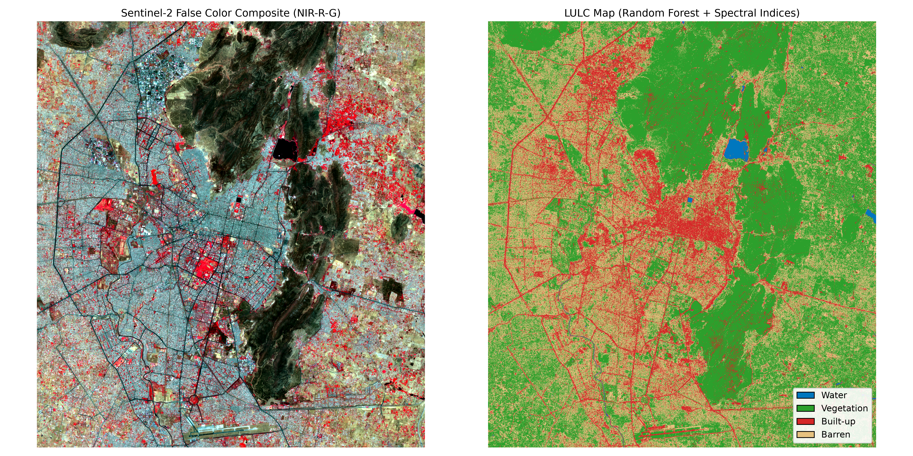

# Automated Land Use / Land Cover (LULC) Classification — Jaipur, India

An end-to-end, reproducible geospatial machine learning pipeline for Land Use and Land Cover (LULC) mapping across Jaipur, Rajasthan, using multispectral **Sentinel-2** satellite imagery.



---

## 📌 Project Overview
* **Area of Interest (AOI):** Jaipur, Rajasthan, India (UTM Zone 43N)
* **Data Source:** Sentinel-2 Level-2A Cloud-Optimized GeoTIFFs (COGs) via Element84 STAC
* **Spatial Resolution:** 10 m Ground Sample Distance (GSD)
* **Model:** Balanced Random Forest Classifier (`scikit-learn`)
* **Classes:** Water (1), Vegetation (2), Built-up (3), Barren / Open Ground (4)

---

## 🔬 Feature Engineering Pipeline
To resolve spectral confusion between dry soil and urban surfaces in arid environments, raw bands were expanded into a 6-dimensional feature space per pixel:
1. **NIR (Band 8)**
2. **Red (Band 4)**
3. **Green (Band 3)**
4. **NDVI (Normalized Difference Vegetation Index):** $\frac{\text{NIR} - \text{Red}}{\text{NIR} + \text{Red}}$
5. **NDWI (Normalized Difference Water Index):** $\frac{\text{Green} - \text{NIR}}{\text{Green} + \text{NIR}}$
6. **Soil/Built Ratio:** $\frac{\text{Red} - \text{Green}}{\text{Red} + \text{Green}}$

---

## 📊 Quantified Area Statistics

| Class ID | Land Cover Class | Spatial Area ($\text{km}^2$) | Coverage (%) |
| :---: | :--- | :---: | :---: |
| **1** | **Water** (Jal Mahal / Man Sagar) | 2.13 | 0.5% |
| **2** | **Vegetation** (Aravalli Range / Urban Greenery) | 237.16 | 53.9% |
| **3** | **Built-up** (Walled City & Urban Footprint) | 71.19 | 16.2% |
| **4** | **Barren** (Semi-arid open soils) | 129.52 | 29.4% |

---

## 🚀 Repository Structure
```text
├── data/
│   └── jaipur_training.geojson       # Verified pure ground-truth geometries
├── notebooks/
│   └── 01_jaipur_lulc_pipeline.ipynb # Fully executed end-to-end Jupyter Notebook
├── outputs/
│   ├── jaipur_lulc_preview.png       # Thematic classification visual preview
│   └── ndvi_preview.png              # Spatial NDVI index distribution
├── 01_stream_jaipur.py               # Cloud STAC querying and band ingestion
├── 02_stream_fcc.py                  # False Color Composite (FCC) creation
├── 03_train_classifier.py            # Supervised model training and scene inference
├── requirements.txt
└── README.md